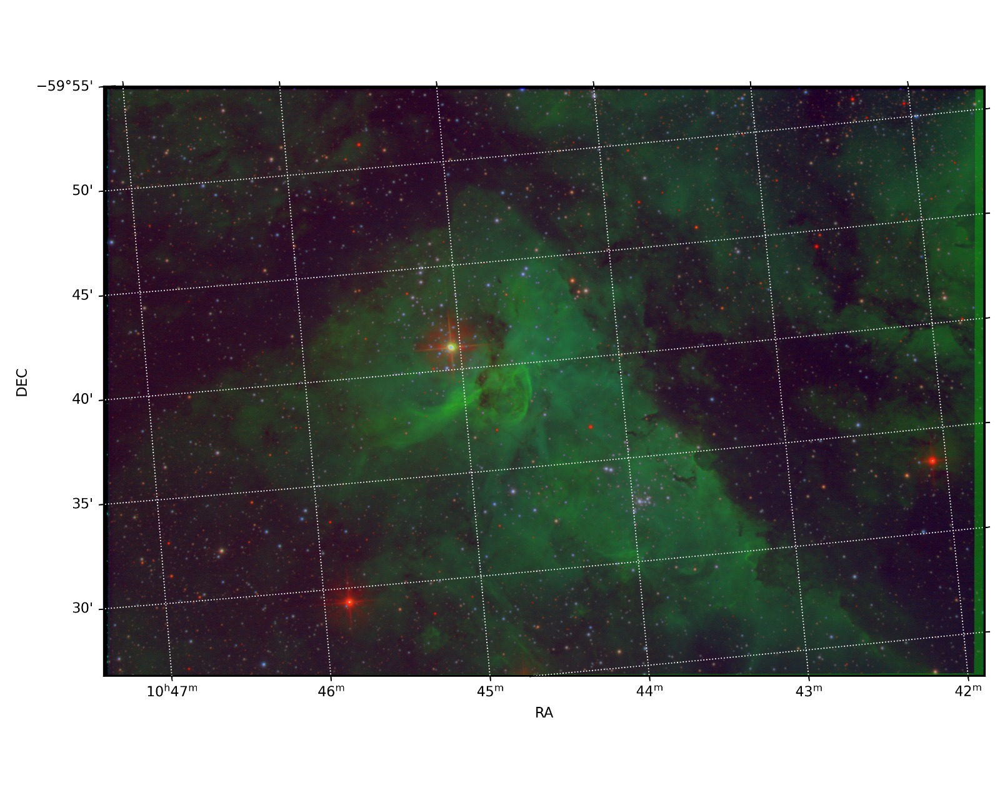

# robo43-reduction-pipeline (DEV version)
Pipeline to process ROBO43 data

This repository contains a set o modules to process the ROBO43 photometric data. The modules are written in Python and use various libraries such as NumPy, SciPy, and Astropy.

## Usage

The module ``make_thumb.py`` produces a thumbnail image from a FITS file for a quick look.

The module ``collect_night_info.py`` collects the night information from the FITS headers and saves it to a CSV file.

The module ``make_calibration_frames.py`` creates master calibration frames (bias, dark, flat) from a set of raw calibration frames.

The module ``process_robo43_frames.py`` processes the raw science frames using the master calibration frames and performs astrometric calibration.

Module ``coadd_frames.py`` coadds multiple weighted science frames to improve the signal-to-noise ratio.

Module ``make_coloured_images.py`` creates coloured images from the processed science frames.

## TODO
- **Resolve the ADU-versus-electron gain convention across the whole pipeline.**
  Blocks the photometry stage: every place that applies a gain, declares
  `BUNIT`, or passes a gain to an external routine must agree on whether the
  array it holds is in ADU or in electrons. Reduced products currently carry
  `BUNIT = 'electron'` alongside `CRFRAC = 0.315`, i.e. astroscrappy flagged
  31.5% of all pixels as cosmic rays, which points at a wrong unit assumption
  in the gain handed to it.
- Add more documentation and examples
- Add module to gather the photometry
- Add more diagnostic plots
- Improve the astrometric calibration
- Add dark frame scaling based on temperature and exposure time
- Create hot pixel mask

## Example

The following example image from the Eta Car Nebula was obtained using the ROBO43 telescope and processed using this pipeline:

